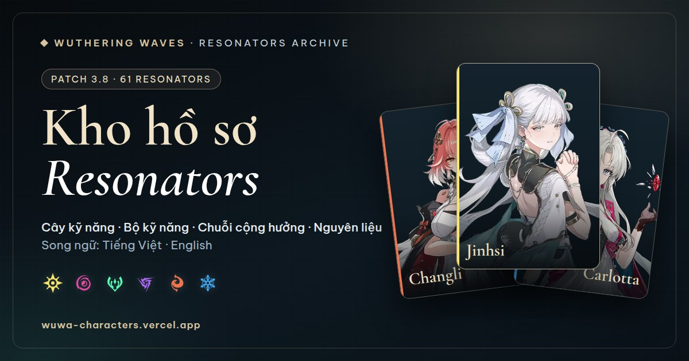
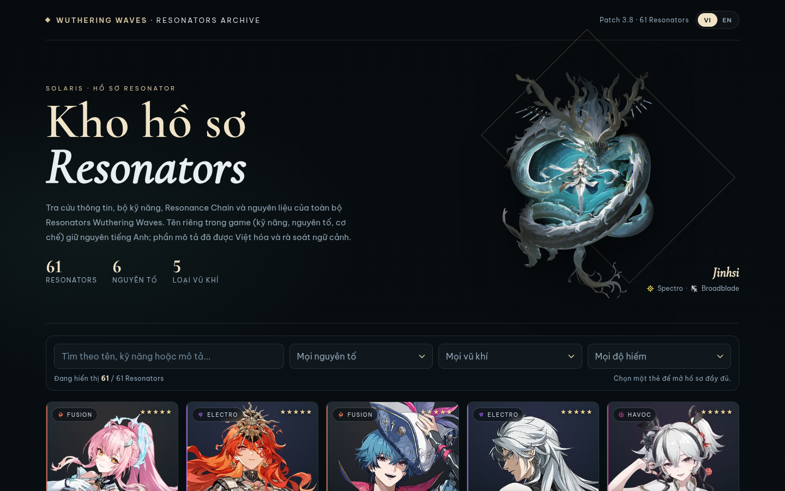
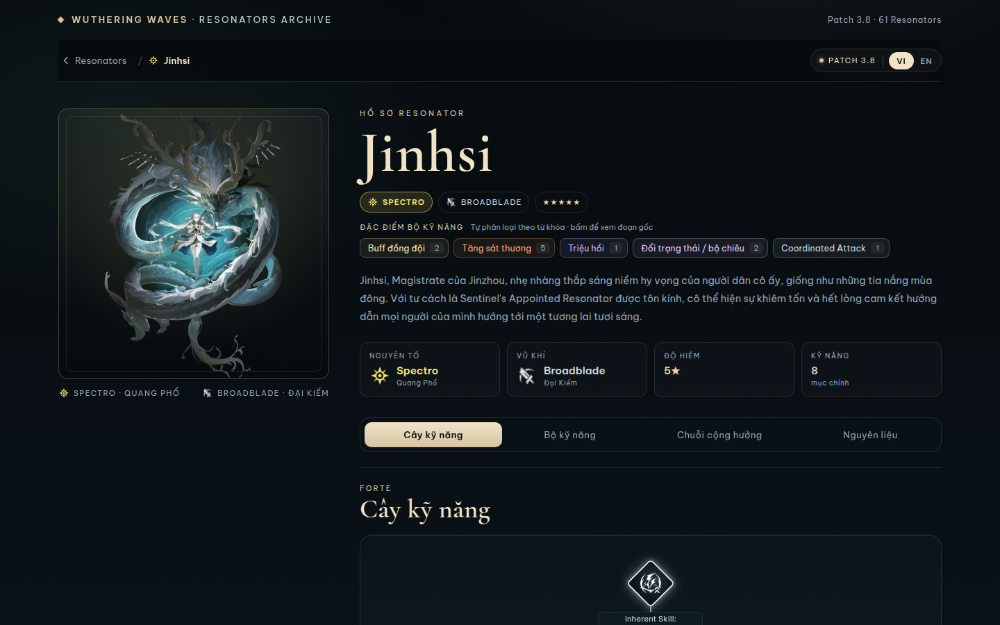
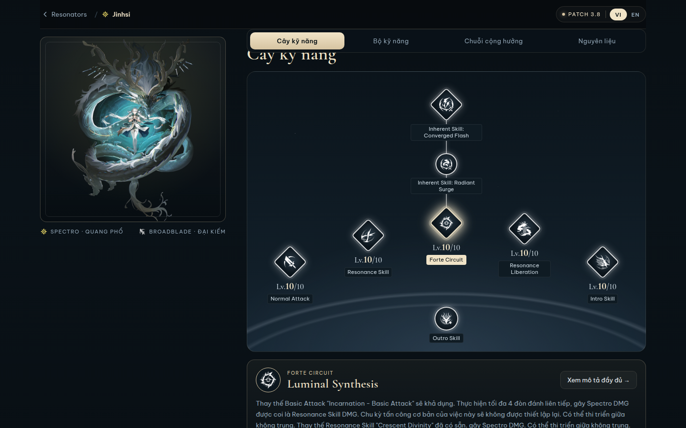
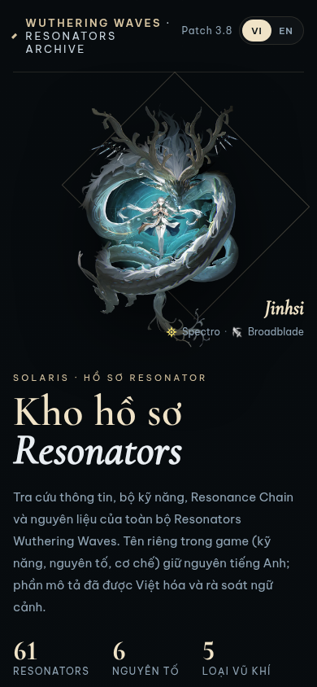

<div align="center">
  

  <h1>Wuthering Waves — Resonators Archive</h1>

  <p><strong>Kho hồ sơ, bộ kỹ năng và dữ liệu nâng cấp của 61 Resonators Wuthering Waves</strong><br>
  Song ngữ Việt · Anh, cập nhật theo bản game hiện tại.</p>

  <p>
    <a href="https://wuwa-characters.vercel.app"></a>
    
    
    
    
    
  </p>

  <p>
    <a href="https://wuwa-characters.vercel.app">Mở bản production</a> ·
    <a href="AGENTS.md">Quy tắc dự án</a> ·
    <a href="https://github.com/devmindtan/wuwa-characters/issues">Báo lỗi</a>
  </p>
</div>

> **Trạng thái:** dữ liệu bản **3.8** (12/11/2026) · **61 Resonators** · **505 kỹ năng** · **360 node Resonance Chain** · ảnh icon và vật phẩm lưu nội bộ.

## Mục lục

- [Giới thiệu](#giới-thiệu)
- [Điểm nổi bật](#điểm-nổi-bật)
- [Ảnh chụp giao diện](#ảnh-chụp-giao-diện)
- [Chạy dự án](#chạy-dự-án)
- [Kiến trúc](#kiến-trúc)
- [API](#api)
- [Dữ liệu và phiên bản](#dữ-liệu-và-phiên-bản)
- [Pipeline dữ liệu](#pipeline-dữ-liệu)
- [Kiểm thử và chất lượng](#kiểm-thử-và-chất-lượng)
- [Triển khai](#triển-khai)
- [Hiệu năng và cache](#hiệu-năng-và-cache)
- [Đóng góp](#đóng-góp)
- [Bản quyền và nguồn](#bản-quyền-và-nguồn)

## Giới thiệu

**Resonators Archive** là công cụ tra cứu phi thương mại dành cho người chơi Wuthering Waves. Dự án gom hồ sơ nhân vật, toàn bộ bộ kỹ năng, cây Forte, hệ số kỹ năng Lv1–10, Resonance Chain, nguyên liệu nâng cấp và phần giải thích cơ chế vào một giao diện thống nhất.

Mục tiêu của dự án không phải dịch lại wiki, mà là **giữ nguyên thuật ngữ game** để người chơi đối chiếu chính xác với trong game, đồng thời cung cấp phần mô tả tiếng Việt đã rà soát ngữ cảnh. Mọi dữ liệu đều có nguồn tham khảo riêng.

- **Bản game hiện tại:** 3.8, phát hành 12/11/2026.
- **Dữ liệu:** 61 Resonators, 505 kỹ năng, 360 node Resonance Chain, đầy đủ nguyên liệu và chi phí từng cấp.
- **Ngôn ngữ:** tiếng Việt là mặc định; công tắc **VI | EN** đổi toàn bộ giao diện và nội dung.
- **Tên riêng trong game** (kỹ năng, nguyên tố, cơ chế, vật phẩm) luôn giữ tiếng Anh ở cả hai ngôn ngữ.

## Điểm nổi bật

### Hồ sơ Resonator

- Ảnh full, nguyên tố, vũ khí, độ hiếm và giới thiệu nhân vật.
- **Skill Tree** theo bố cục Forte trong game, có icon gốc và cấp kỹ năng.
- Tab **Combat Skills** với mô tả đầy đủ, icon từng kỹ năng và bảng hệ số mở rộng.
- Thanh kéo **Lv.1–10** cập nhật đồng thời hệ số kỹ năng, node cây và bảng chỉ số.
- **Resonance Chain** S1–S6, kèm bản EN gốc để đối chiếu.
- **Nguyên liệu**: tổng nguyên liệu và chi phí theo từng cấp, icon vật phẩm lưu nội bộ.
- Mục **Tham khảo** ghi rõ nguồn cho từng phần dữ liệu.

### Tra cứu và liên kết

- Tìm kiếm toàn văn theo tên, giới thiệu, kỹ năng và Resonance Chain, ở cả EN và VI.
- Bộ lọc nguyên tố, vũ khí và độ hiếm; bộ lọc tùy biến có hỗ trợ bàn phím.
- Trong mô tả kỹ năng, tên kỹ năng khác của cùng nhân vật là liên kết: bấm để cuộn tới đúng mục và làm nổi bật.
- Thuật ngữ cơ chế mở **popup giải thích** kèm:
  - định nghĩa trích từ dữ liệu nguồn;
  - các vị trí xuất hiện trong bộ kỹ năng;
  - danh sách Resonators dùng cùng cơ chế và vai trò tương ứng.
- Đòn con, đặc điểm bộ kỹ năng và nhãn vai trò được phân loại tự động, có dòng bằng chứng và liên kết tới đúng đoạn mô tả.
- Tooltip tùy chỉnh, không phụ thuộc tooltip mặc định của trình duyệt.

### Trải nghiệm

- Giao diện tối, responsive cho desktop, tablet và mobile.
- Song ngữ toàn trang, lưu lựa chọn bằng `localStorage`.
- Font và icon được kiểm soát để giữ đúng không khí game.
- Ảnh xem trước khi chia sẻ link (Open Graph/Twitter Card) 1200×630.
- Không cần bước build frontend: HTML/CSS/JS tĩnh + ES module.

## Ảnh chụp giao diện

| Danh sách Resonators | Hồ sơ và Skill Tree |
|---|---|
|  |  |

| Cây kỹ năng Forte | Giao diện mobile |
|---|---|
|  |  |

## Chạy dự án

### Yêu cầu

- Python **3.10+** (đã kiểm tra trên 3.12).
- Trình duyệt hiện đại; JavaScript bật.
- Khi chạy test E2E: Node.js và Chrome/Chromium.

### Chạy local

```bash
git clone git@github.com:devmindtan/wuwa-characters.git
cd wuwa-characters
./run.sh
```

Mở <http://127.0.0.1:8000>.

`run.sh` tự tạo `.venv`, cài `requirements.txt` và chạy Uvicorn với `--reload`. Nếu muốn chạy thủ công:

```bash
python3 -m venv .venv
.venv/bin/pip install -r requirements.txt
.venv/bin/uvicorn app.main:app --host 127.0.0.1 --port 8000 --reload
```

Frontend gọi API cùng origin; không cần cấu hình biến môi trường cho môi trường local.

## Kiến trúc

```
app/main.py                  FastAPI: API JSON + phục vụ public/ khi chạy local
data/
  characters.json            Dữ liệu canonical (meta.patch, hồ sơ, kỹ năng, chain, materials)
  mechanics_curated.json     Nội dung cơ chế do người viết (VI/EN, owner, nguồn)
  mechanics.json             Cơ chế sinh bởi scripts/build_mechanics.py
  kit_index.json             Đòn con, đặc điểm, Resonators theo cơ chế (build_index.py)
  translations/              Bản dịch Resonance Chain và override kỹ năng
public/
  index.html                 Shell của ứng dụng
  styles.css                 Design system và giao diện
  js/                        ES module: core, i18n, list, detail, kit, links, mechanics, tooltip
  assets/                    Icon, ảnh nhân vật, vật phẩm, OG image
scripts/                     Pipeline dữ liệu, kiểm tra và build index
tests/                       pytest + E2E smoke test
docs/screenshots/            Ảnh dùng trong README
.githooks/                   pre-commit và commit-msg
vercel.json                  Cấu hình Functions và cache headers
AGENTS.md                    Quy tắc dự án và quy trình kiểm chứng
```

### Luồng tải dữ liệu

1. Trang mở bằng `/api/summary` (~16 KB, ~2 KB gzip) để render danh sách ngay.
2. `/api/search` được tải ngầm để tìm kiếm toàn văn.
3. Khi mở một hồ sơ, frontend gọi `/api/characters/{slug}` và cache kết quả trong bộ nhớ.
4. `/api/mechanics` và `/api/index` cung cấp nội dung popup và phân loại đã sinh sẵn.
5. Frontend không nhúng dữ liệu và không tự phân loại; mọi quy tắc nằm ở pipeline Python.

## API

Tất cả endpoint trả JSON, không yêu cầu xác thực.

| Endpoint | Mô tả |
|---|---|
| `GET /api/health` | Kiểm tra server và bản game hiện tại |
| `GET /api/meta` | `meta.patch`, ngày cập nhật, số Resonators/kỹ năng, số hồ sơ có thay đổi |
| `GET /api/summary` | Dữ liệu gọn cho trang danh sách (không gồm mô tả kỹ năng) |
| `GET /api/search` | Blob tìm kiếm toàn văn theo slug, gồm EN + VI |
| `GET /api/characters` | Toàn bộ dữ liệu nhân vật (dùng cho tra cứu/tích hợp) |
| `GET /api/characters/{slug}` | Một hồ sơ đầy đủ; `404` nếu không tồn tại |
| `GET /api/mechanics` | Cơ chế/thuật ngữ, định nghĩa và các vị trí xuất hiện |
| `GET /api/index` | Chỉ mục đòn con, đặc điểm, Resonators và vai trò theo cơ chế |
| `GET /api/changes` | Các hồ sơ có thay đổi thông tin trong game, kèm lịch sử |
| `GET /api/version` | Bản game hiện tại và ngày cập nhật |

Ví dụ:

```bash
curl http://127.0.0.1:8000/api/version
curl http://127.0.0.1:8000/api/characters/jinhsi
```

Response được nén gzip khi client hỗ trợ. Các endpoint lớn nên được gọi khi thật sự cần; giao diện chính chỉ dùng bản rút gọn.

## Dữ liệu và phiên bản

`meta.patch` trong `data/characters.json` là bản game mới nhất và là phiên bản duy nhất giao diện hiển thị. Khi game ra bản mới:

1. Kiểm tra nguồn chính thức/tin tức.
2. Cập nhật `meta.patch` và `meta.updated`.
3. Cập nhật số patch/số Resonators trong `public/index.html` và `scripts/og/og.html`.
4. Chạy `node scripts/og/render.js` để tạo lại ảnh chia sẻ.

Mỗi hồ sơ có `changes`, **chỉ ghi khi thông tin trong game thay đổi** (kỹ năng, chỉ số, mô tả gốc EN, ảnh…). Sửa bản dịch, giao diện hoặc tài liệu không ghi vào `changes`.

```json
{
  "slug": "jinhsi",
  "changes": [
    { "version": "3.9", "date": "2026-12-23", "note": "Cập nhật hệ số Resonance Liberation" }
  ]
}
```

Quy ước đầy đủ ở [AGENTS.md §1](AGENTS.md).

## Pipeline dữ liệu

Chạy bằng Python trong `.venv`:

| Script | Việc làm |
|---|---|
| `scripts/extract.py` | Tải dữ liệu nhân vật từ prydwen.gg, ghi `data/en_raw.json` (local, không commit). |
| `scripts/fetch_wiki.py` | Lấy Resonance Chain, nguyên liệu và hệ số kỹ năng từ Wuthering Waves Wiki qua MediaWiki API; cache `data/wiki_raw.json` (local). |
| `scripts/merge_wiki.py` | Ghi chain, materials, references vào `characters.json`; ghép bản dịch và báo node còn thiếu. |
| `scripts/fix_context.py` | Khôi phục tên riêng/thuật ngữ bị dịch máy về tiếng Anh, đối chiếu từng dòng EN. |
| `scripts/apply_overrides.py` | Áp các dòng dịch thủ công khi bản EN gốc vẫn khớp. |
| `scripts/check_names.py` | Phát hiện bản dịch làm mất tên riêng của game. |
| `scripts/review.py` | Kiểm tra glossary, schema, số dòng, con số khớp EN và in mẫu để đọc tay. |
| `scripts/build_mechanics.py` | Sinh `data/mechanics.json` từ nội dung curated + thuật ngữ kit. |
| `scripts/build_index.py` | Sinh `data/kit_index.json`: đòn con, tag đặc điểm, Resonators/vai trò theo cơ chế. |
| `scripts/stamp_assets.py` | Ghi `?v=<hash>` cho CSS/JS trong `index.html`; `--check` dùng cho hook. |
| `scripts/og/render.js` | Render lại ảnh Open Graph 1200×630. |

Thứ tự khuyến nghị:

```text
fetch_wiki → merge_wiki → fetch_assets → apply_overrides → check_names
→ review → build_mechanics → build_index → stamp_assets
```

Không publish bản dịch máy thô. Sau khi dịch phải chạy `review.py`, đọc hết dòng bị đánh dấu và rà thêm mẫu ngẫu nhiên.

## Kiểm thử và chất lượng

```bash
# Kiểm tra dữ liệu, glossary, schema
.venv/bin/python scripts/review.py --sample 10

# Unit/integration test cho API, dữ liệu và frontend
.venv/bin/pip install -r requirements-dev.txt
.venv/bin/python -m pytest -q tests

# E2E desktop + mobile; cần server đang chạy và Chrome
node tests/e2e/smoke.js

# Kiểm tra bản production
BASE_URL=https://wuwa-characters.vercel.app node tests/e2e/smoke.js
```

Nếu `playwright-core` chưa có trong môi trường Node:

```bash
npm install --no-save playwright-core
# hoặc trỏ tới bản đã cài
PLAYWRIGHT_CORE=/duong/dan/playwright-core node tests/e2e/smoke.js
```

Kiểm tra nhanh API:

```bash
for u in /api/health /api/meta /api/summary /api/characters/jinhsi /api/mechanics; do
  printf '%s ' "$u"; curl -s -o /dev/null -w '%{http_code}\n' "http://127.0.0.1:8000$u"
done
```

## Triển khai

Bản production: **<https://wuwa-characters.vercel.app>**

Dự án dùng Vercel Functions với FastAPI. Không có bước build frontend; Vercel tự nhận `app/main.py`, cài `requirements.txt` và đóng gói function.

```bash
npx vercel          # preview
npx vercel --prod   # production
```

Cấu hình quan trọng:

- `public/` được Vercel phục vụ từ CDN; `app/main.py` chỉ mount static khi không có biến `VERCEL`.
- `vercel.json` khai báo `includeFiles: "data/**"` để JSON runtime nằm trong bundle function.
- Cache header: `assets/*` dài hạn, CSS/JS/HTML luôn revalidate.
- Không cần đặt Build Command; để trống trong Project Settings.

## Hiệu năng và cache

- Danh sách dùng `/api/summary` (~16 KB; ~2 KB gzip) thay vì toàn bộ dữ liệu ~2 MB.
- Hồ sơ đầy đủ chỉ tải khi mở và được cache trong bộ nhớ trình duyệt.
- Tìm kiếm toàn văn tải ngầm, không chặn lần render đầu.
- Gzip bật ở FastAPI cho response lớn.
- CSS/JS có query hash để tránh cache lẫn phiên bản; ảnh tĩnh được cache 7 ngày.
- Ảnh full của nhân vật giữ remote; icon, vật phẩm và ảnh card lưu nội bộ.

## Đóng góp

1. Đọc [AGENTS.md](AGENTS.md) trước khi sửa.
2. Bật hook một lần sau khi clone:

```bash
git config core.hooksPath .githooks
```

3. Tạo branch riêng cho thay đổi lớn, chạy kiểm chứng ở trên, rồi commit theo định dạng:

```text
<type>(<scope>): <tóm tắt>
```

Các type: `feat`, `fix`, `data`, `i18n`, `ui`, `api`, `docs`, `chore`, `refactor`, `test`.

- Hook `pre-commit` chặn JSON hỏng, `review.py`/pytest fail, thiếu entry `changes`, sửa lịch sử cũ, quên stamp asset hoặc stage nhầm file local.
- Tách commit dữ liệu (`data/`) khỏi commit UI/code.
- Với thay đổi giao diện, kiểm tra desktop + mobile và cập nhật ảnh trong `docs/screenshots/` nếu cần.

## Bản quyền và nguồn

- Dữ liệu nhân vật tham chiếu từ [prydwen.gg](https://www.prydwen.gg/wuthering-waves/characters).
- Resonance Chain, nguyên liệu và hệ số kỹ năng tham chiếu từ [Wuthering Waves Wiki (Fandom)](https://wutheringwaves.fandom.com/) qua MediaWiki API công khai.
- Icon nguyên tố, vũ khí, kỹ năng và vật phẩm là tài nguyên trong game, thuộc bản quyền Kuro Games.
- Đây là dự án tra cứu phi thương mại của người hâm mộ, không liên kết chính thức với Kuro Games.

## Tác giả

**Nguyễn Khắc Minh Tân**

[devmind.tan@gmail.com](mailto:devmind.tan@gmail.com) · [GitHub](https://github.com/devmindtan/wuwa-characters) · [Facebook](https://www.facebook.com/tan.deptrai.104/)
